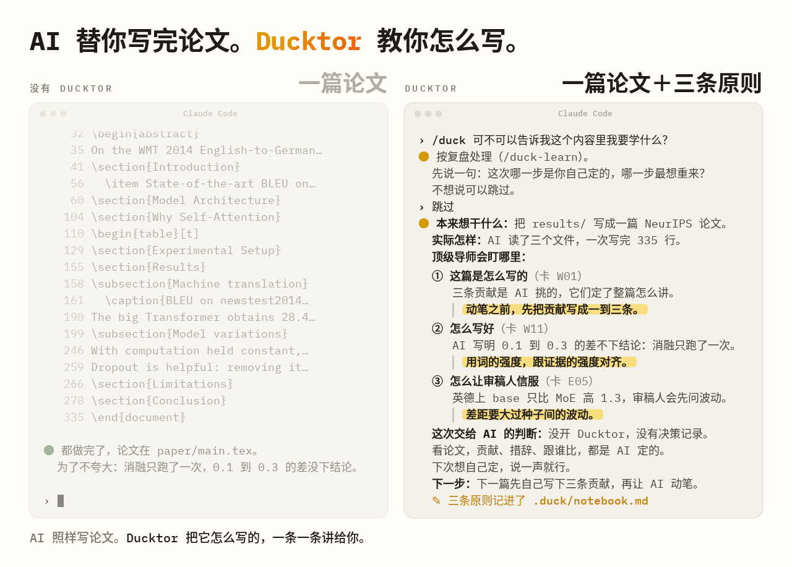

<p align="center">
  <picture>
    <source media="(prefers-color-scheme: dark)" srcset="assets/logo-dark.png">
    
  </picture>
</p>

<h1 align="center">Ducktor</h1>

<p align="center">
  <b>面向 AI 科研时代的「方法论与认知闭环」插件</b><br>
  当 Agent 将科研流程加速为 <code>Data In, Paper Out</code> 的黑盒，研究者如何避免沦为被动的旁观者？<br>
  Ducktor 适配主流 Agent Harness 平台，在推进研究的同时，为你补齐缺失的导师指引与科研训练闭环。<br>
  <b>Trust me, I'm a Ducktor.</b>
</p>

<p align="center">
  <sub>当前处于早期测试阶段（Early Preview），欢迎提交 Issue 或 PR，我们将持续快速迭代。</sub>
</p>

<p align="center">
  
  
</p>

<p align="center">
  
</p>

<p align="center">
  <sub>简体中文 · <a href="i18n/README.en.md">English</a></sub>
</p>

---

## 为什么做 Ducktor

在 **Vibe Research** 浪潮下，编码与科研 Agent 极大地压缩了从实验到成文的周期。但这也是我们在开源 [Supervisor-Skills](https://github.com/HKUSTDial/Supervisor-Skills)（）并获得学界与业界广泛认可后，愈发担忧的一个问题：**当 AI 接管了执行细节，研究者（尤其是高年级本科生与低年级研究生）还能否从科研过程中习得真正的学术判断力？**

在社区反馈中我们发现，许多研究者依赖 `Supervisor-Skills` 获取结构化的科研认知，但静态的技能库仍缺少**伴随式的实时指导**。与此同时，当前多数自动化科研工具本质上是一个开环系统：**Data In, Paper Out**。Agent 替你完成了所有隐性决策（如何界定核心贡献、结论下到什么分寸、消融实验如何归因），而人却被排除在思考回路之外。

**Ducktor 旨在打破这种「执行加速、认知空心化」的困境，构建属于研究者的知识闭环：**

1. **注入顶尖学术品味**：输入不再只是实验数据，还将顶尖学者的方法论、审稿标准与你们课题组的经验共同作为上下文约束。
2. **过程拆解与实时对齐**：在 Agent 推进研究的关键节点，Ducktor 主动暴露背后的学术取舍（Trade-offs），将隐性判断转化为可习得的显性原则。
3. **能力与成果双重沉淀**：在打磨出高质量论文的同时，生成可溯源的决策日志与个人科研笔记，让研究者的学术直觉与 Agent 同步进化。

<details>
<summary><b>💡 为什么取名为 Ducktor？</b></summary>
<br>
灵感源于软件工程中的<a href="https://zh.wikipedia.org/wiki/%E5%B0%8F%E9%BB%84%E9%B8%AD%E8%B0%83%E8%AF%95%E6%B3%95">小黄鸭调试法（Rubber Duck Debugging）</a>：工程师通过向桌上的小黄鸭逐行解释代码逻辑，在自我审视与复述中发现盲区、厘清思路。<b>Ducktor（Duck + Doctor/Mentor）</b> 扮演的正是终端里这只戴博士帽的“学术小黄鸭”：通过高频、轻量的方法论互动，帮你夺回对研究过程的掌控力与思考深度。
</details>

---

## 核心体验：之前 vs. 之后

<p align="center">
  
</p>

当你把实验结果交给常规 AI 撰写论文时，AI 会一次性输出初稿。**核心贡献如何提炼、结论措辞的强弱边界、对比基线的合理性**，全部由模型在黑盒中自行决断。你可能拿到了一篇通顺的草稿，却错失了最重要的方法论训练，也为后续审稿埋下了隐患。

引入 Ducktor 后，同样的任务被重构为透明的教研闭环：
- 使用 `/duck-outline` 梳理主线逻辑，`/duck-write` 撰写正文，`/duck-review` 以审稿人视角严苛自查。
- 每完成一个关键阶段，Ducktor 都会为你提炼三要素：**这一步的核心取舍（Why）**、**一条可迁移的科研原则（Principle）**，以及**下次你可以主动前置的操作建议（Next Time）**。

---

## 核心机制与工作流

Ducktor 并不替换你现有的底层模型，而是作为一套轻量级规则、Hook 与技能层，引导你的 AI 扮演严谨的学术导师。

### 1. 双模式运行与「证据护栏」

安装后，Ducktor 默认处于**按需模式**，仅在你显式调用 `/duck-*` 命令时介入。在项目根目录下执行 `/duck on` 后，将开启当前项目的**伴随指导模式**（或使用 `/duck quiet` 开启仅记录、不输出的静默模式）：

* **即时方法论点拨**：当 AI 完成具有实质意义的研究动作（如确定技术路线、调整实验设计、完成核心段落撰写），Ducktor 会在回复末尾用一两句话点出背后的科研考量。
* **关键决策前置征询**：面对会改变研究走向的重大取舍，AI 在动手前会先向你确认（单次最多提出 3 个核心问题，避免过度打扰）。
* **结果入文前的「证据护栏」**：当你在伴随模式下要求 AI 将实验数据写入表格或推导结论时，Ducktor 会前置核查三项审稿级红线（发现隐患将暂停写入并征询你的意见）：
  1. **统计显著性**：实验是否仅运行了单次？性能差距是否大于不同随机种子（Seed）间的波动？
  2. **归因解耦**：当出现大幅性能提升时，收益来源（如参数量扩张、训练步数增加 vs. 方法本身改进）是否已拆解清楚？
  3. **主张与证据对齐**：行文结论的措辞强度，是否超出了现有实验证据的支撑范围？

> 📌 *注：显式执行 `/duck-*` 命令时，工作流将遵循对应命令的专属步骤，上述三项检查将在命令结束时通过「经验卡」形式提示。关于开启 Ducktor 前后的真实对话对比，请参阅评测集 [evals/before-after/](evals/before-after/)。*

### 2. 事后追问（`/duck-why`）与阶段复盘（`/duck-learn`）

* **即时追问 (`/duck` & `/duck-why`)**：即使 AI 已经执行完毕，你也可以随时输入 `/duck <你的问题>`（例如 `/duck 这一步有哪些值得注意的科研规范？`），系统会自动路由至最匹配的命令进行解答。调用 `/duck-why` 时，Ducktor 会针对刚才的操作（或你指定的文件、Git Commit、段落），聚焦剖析**最值得学习的一处细节**：对比新手常见误区与资深学者思路、给出名家文献出处、指明数据核对路径，并沉淀出一条**加粗原则**与**下次行动指南**。
* **阶段复盘 (`/duck-learn`)**：在一个研究阶段告一段落时调用。它会先询问你*“哪一步是由你亲自拍板的？哪一步最想推倒重来？”*（可跳过），随后结合项目中的决策记录、报告与笔记，对比“初始预期”与“实际产出”，指出顶尖导师会重点审视的薄弱环节，并梳理出此前完全托管给 AI 的判断清单，帮助你逐步收回学术主导权。

### 3. 个人知识沉淀与决策溯源（`.duck/`）

Ducktor 将过程中的认知资产以纯文本 Markdown 存储在项目本地的 `.duck/` 目录下：

* **科研原则笔记本 (`.duck/notebook.md`)**：按行记录提炼出的科研原则。下次执行同类任务时，Ducktor 会自动检索并唤醒相关历史原则。如果你表示“这类原则我已经掌握”，后续将转为只记录、不重复说教。
* **决策溯源日志 (`.duck/decisions.md`)**：按行记录研究过程中的关键取舍，并明确标注决策者（`Human` 或 `AI`）。
* **复盘与精讲报告 (`.duck/reports/`)**：存档 `/duck-learn` 与 `/duck-why` 的深度分析。

所有记录均为标准 Markdown 文件，可直接随论文代码库提交至 Git（组会上面对导师追问“当时为什么这样设计实验”，可随时溯源）；若无需入库，将 `.duck/` 加入 `.git/info/exclude` 即可。

### 4. 可溯源的导师知识库（拒绝凭空说教）

为避免大模型产生空洞的“正确的废话”，Ducktor 阐述方法论时的引用严格限定于以下四个来源（若无明确出处，Ducktor 会坦诚声明这仅是当前模型的推论）：

* **[经验卡 (Experience Cards)](cards/INDEX.md)**：内置 23 张高频科研经验卡，涵盖适用场景、操作准则与文献溯源（例如 `W11`：行文措辞强度必须与实验证据强度严格对齐）。
* **[名家方法论索引 (Mentors)](cards/MENTORS.md)**：结构化提炼 Richard Hamming、John Schulman、Andrej Karpathy、Jennifer Widom 等学者的经典科研方法论文章要点，并附原文链接。
* **[科研手册 (Handbook)](handbook/)**：源自 [Supervisor-Skills](https://github.com/HKUSTDial/Supervisor-Skills) 的系统化科研指南。
* **课题组自定义经验卡**：支持通过 `/duck-skill` 注入你们实验室内部的审稿偏好与写作规范（发生冲突时，优先以课题组自定义规则为准）。

---

## 仓库架构

开启 Ducktor 的项目会在每次会话初始化时加载常驻规则 [`rules/core.md`](rules/core.md)（针对仅支持规则文件的工具提供 [`AGENTS.md`](AGENTS.md)）。核心组件分布如下：

* [`skills/`](skills/)：14 条交互命令的定义与编排逻辑。
* [`library/`](library/)：完整集成的 10 项 [Supervisor-Skills](https://github.com/HKUSTDial/Supervisor-Skills) 核心科研技能（涵盖文献综述、Idea 评估、投稿前审稿等）。
* [`cards/`](cards/) & [`handbook/`](handbook/)：内置经验卡、名家文章索引与科研手册。
* `bin/`、`hooks/`、`scripts/`：多平台插件适配脚本与生命周期 Hook。

---

## 安装与快速开始

**环境要求**：Node.js 18 及以上版本。
*(注：当前仓库处于私有测试期，请先确认你的 GitHub 账号已开通访问权限，可通过 `gh repo view yinwu01/Ducktor` 验证。若此前安装过旧版 `Doctor Duck`，请先参照 [INSTALL.md](INSTALL.md) 中的卸载指南清理旧版本。)*

### Claude Code

在终端中执行：

```bash
claude plugin marketplace add yinwu01/Ducktor
claude plugin install duck@ducktor
```

### Codex

在终端中执行：

```bash
codex plugin marketplace add yinwu01/Ducktor
codex plugin add duck@ducktor
```
安装后，请在 Codex 中打开 `/hooks`，信任 Ducktor 注册的两条 Hook，随后开启新会话即可。

### 其他 AI 编程工具（Cursor / Gemini CLI / Qwen Code 等）

将本仓库克隆至本地，把 [`AGENTS.md`](AGENTS.md) 复制到你的目标项目根目录，并在对话中告知 AI 本仓库的本地路径。此模式下常驻规则自动生效；由于无原生斜杠命令支持，可通过自然语言触发（如*“请按照 Ducktor 的 `/duck-review` 流程审阅当前草稿”*）。各平台适配详情请参阅 **[docs/agent-portability.md](docs/agent-portability.md)**。

### 启动验证

1. 在项目**最外层根目录**（新建空目录亦可）启动新的终端会话。
2. 在 Claude Code 中输入 `/duck`（Codex 中输入 `$duck:duck`），Ducktor 将展示极简上手指引与命令菜单。
3. 若希望在日常对话中开启伴随指导，执行一次 `/duck on` 即可。开关状态独立保存在当前项目的 `.duck/config.md` 中，不会污染其他项目（注意：请勿在 `paper/` 等子目录下启动会话，否则无法读取根目录配置）。

> 更多关于版本更新、卸载流程与故障排查，请参阅 **[INSTALL.md](INSTALL.md)**。

---

## 命令参考

| 命令 | 核心作用与适用场景 |
| :--- | :--- |
| `/duck [on \| quiet \| off]` | **总控与智能路由**。不带参数时展示菜单；`on` 开启项目伴随模式；`quiet` 开启静默记录模式；`off` 恢复按需触发模式。后接自然语言（如 `/duck 帮我写引言`）时，自动匹配并执行对应子命令。 |
| `/duck-survey` | **文献调研**：探索研究方向，生成结构化文献综述。 |
| `/duck-idea` | **课题评估**：审视研究 Idea 的新颖性、可行性与潜在审稿风险。 |
| `/duck-vibe` | **人机边界划分**：评估当前模块哪些工作可托管给 AI，哪些核心科学判断必须由研究者亲自把关。 |
| `/duck-outline` | **逻辑架构**：梳理整篇论文的论证脉络（内置技术论文与 Benchmark 论文双模板）。 |
| `/duck-intro` | **引言撰写**：构建“背景→挑战→方法映射→贡献”严密咬合的 Introduction。 |
| `/duck-write` | **正文撰写**：基于真实实验证据撰写方法与实验章节，严控引用真实性。 |
| `/duck-figure` | **图表设计**：规划科研图表结构并核查可视化信息密度与规范。 |
| `/duck-polish` | **学术润色**：提升学术表达的精准度、可读性与行文节奏。 |
| `/duck-review` | **模拟审稿**：在投稿前以顶会 Reviewer 的严苛视角对稿件进行全面体检。 |
| `/duck-why` | **方法论溯源**：深度剖析上一步操作（或指定文件、Commit、段落）背后的学术取舍与名家依据。 |
| `/duck-learn` | **阶段性复盘**：对比预期与结果，诊断薄弱环节，盘点交给 AI 的隐性决策。 |
| `/duck-notes` | **知识库管理**：查看、检索或编辑本地沉淀的 `.duck/notebook.md` 科研原则。 |
| `/duck-skill` | **定制与扩展**：启停特定命令、针对当前项目微调规则，或注入课题组专属经验卡。 |

*注：9 条核心科研工作流命令依赖 `library/` 下的技能库，需完整安装插件方可使用。在 Codex 环境中，请将 `/duck-review` 替换为 `$duck:duck-review`（其余命令同理）。*

---

## 常见问题 (FAQ)

<details>
<summary><b>1. 需要手动编写配置文件吗？</b></summary>
<br>
不需要。执行 <code>/duck on</code> 时会自动在项目下创建 <code>.duck/config.md</code>。后续你可以通过 <code>/duck-skill</code> 启停特定命令或添加自定义经验卡，也可在对话中直接要求“缩短回复篇幅”或“这类知识点无需再讲”，偏好会自动写入配置。
</details>

<details>
<summary><b>2. 未开启 <code>/duck on</code> 的项目会消耗额外上下文吗？</b></summary>
<br>
几乎不会。在未开启伴随模式的项目中，Session Hook 仅向模型上下文注入极简的路径说明（告知插件位置且当前处于关闭状态），AI 完全按原生方式工作；只有当你显式调用 <code>/duck-*</code> 命令时，才会按需加载对应规则。开启 <code>/duck on</code> 后，才会注入完整的常驻导师规则。
</details>

<details>
<summary><b>3. 它会频繁打断我的工作流、或者擅自修改论文吗？</b></summary>
<br>
<b>不会频繁打断</b>：仅当面临会改变研究走向或违背证据护栏的重大取舍时，AI 才会前置提问（且单次不超过 3 个问题）；修改拼写、润色单句等常规操作均直接执行。<br>
<b>不会擅自改稿</b>：只有在你下达修改指令时 AI 才会改动文件。如果你赶时间希望跳过征询，只需说一句<i>“这次不用问我，你直接定”</i>，AI 便会直接执行，并将该决策标记为 <code>AI</code> 记入日志。
</details>

<details>
<summary><b>4. Ducktor 讲述的方法论或引用的数据会出错（幻觉）吗？</b></summary>
<br>
<b>有可能，请始终保持研究者的最终核验权。</b>模型在转述你稿件中的实验数值或他人文献结论时仍可能出现偏差：对于外部文献，请务必点击链接核对标题与摘要；对于文内数据，请对照源文件复核（<code>/duck-why</code> 会明确给出需核对的文件路径与行号）。此外，复盘时关于“AI 当时为何这样做”的分析，是基于文件变更与对话历史的事后逆向推演，并不代表底层模型真实的内部推理状态。
</details>

<details>
<summary><b>5. 插件的权限边界与数据隐私如何保障？</b></summary>
<br>
插件自带的本地 Hook 脚本仅做本地文件读取，<b>绝不联网，也不主动修改业务代码</b>。在 Claude Code 中，Hook 仅对两类安全操作配置了免弹窗放行：（1）读取插件自身目录文件；（2）<code>.duck/</code> 目录初始化后，向笔记本、决策日志追加条目及生成复盘报告。若涉及修改已有笔记、变更配置（<code>config.md</code>）或改动技能卡片（<code>skills/</code>、<code>cards/</code>），依然会正常触发终端授权确认。此外，执行 <code>/duck-survey</code>、<code>/duck-idea</code>、<code>/duck-review</code> 等命令时，AI 会按需调用搜索工具联网检索公开文献。
</details>

<details>
<summary><b>6. Ducktor 会对研究者进行能力评分吗？</b></summary>
<br>
不会。Ducktor 不出考题，也不对使用者打分。<code>/duck-idea</code> 评估的是课题方案的成熟度，<code>/duck-review</code> 审视的是论文手稿的质量：<b>我们评估的是研究客体，而非研究者本人。</b>
</details>

---

## 来源与致谢

* **命名灵感**：源自《程序员修炼之道》（*The Pragmatic Programmer*）提出的小黄鸭调试法（[Rubber Duck Debugging](https://en.wikipedia.org/wiki/Rubber_duck_debugging)）。
* **核心方法论与技能库**：科研手册（`handbook/`）与 10 项底层科研技能（`library/`）源自香港科技大学（广州）数据智能与分析实验室开源的 [Supervisor-Skills](https://github.com/HKUSTDial/Supervisor-Skills)（Copyright © 2026 Yuyu Luo and contributors）。本仓库提交历史自上游 `c243997`（2026-07-01）分支演进，完整保留了上游历史提交与作者署名；`library/` 与 `handbook/` 内容同步自上游 `aff5de9`（2026-07-16）。
* **示例数据说明**：README 演示图表中引用的对比实验数据，取自经典论文 *Attention Is All You Need*（[arXiv:1706.03762](https://arxiv.org/abs/1706.03762)）的 Table 2 与 Table 3。
* **工程致谢**：README 的文档叙事受 [ponytail](https://github.com/DietrichGebert/ponytail)（MIT）启发；多平台 Agent Harness 的兼容架构参考了 `ponytail` 与 [superpowers](https://github.com/obra/superpowers)。

---

## 许可证 (License)

本项目采用分目录多重许可策略：
* **方法论文档与视觉资产**：本项目原创的规则与卡片（`skills/`、`rules/`、`cards/`）、科研手册（`handbook/`）及配图资产（`assets/`）采用 **CC BY-NC-SA 4.0** 协议（非商业性使用-相同方式共享）。
* **工程代码**：脚手架、Hook 与测试脚本（`bin/`、`hooks/`、`scripts/`、`tests/`）采用 **MIT** 协议。
* **上游技能库**：`library/` 目录下的科研技能保留各自的上游许可证（其中 6 项采用 **CC BY 4.0**，4 项采用 **CC BY-NC-SA 4.0**）。

完整许可条款请参阅 [LICENSE](LICENSE) 与 [LICENSES/README.md](LICENSES/README.md)。
