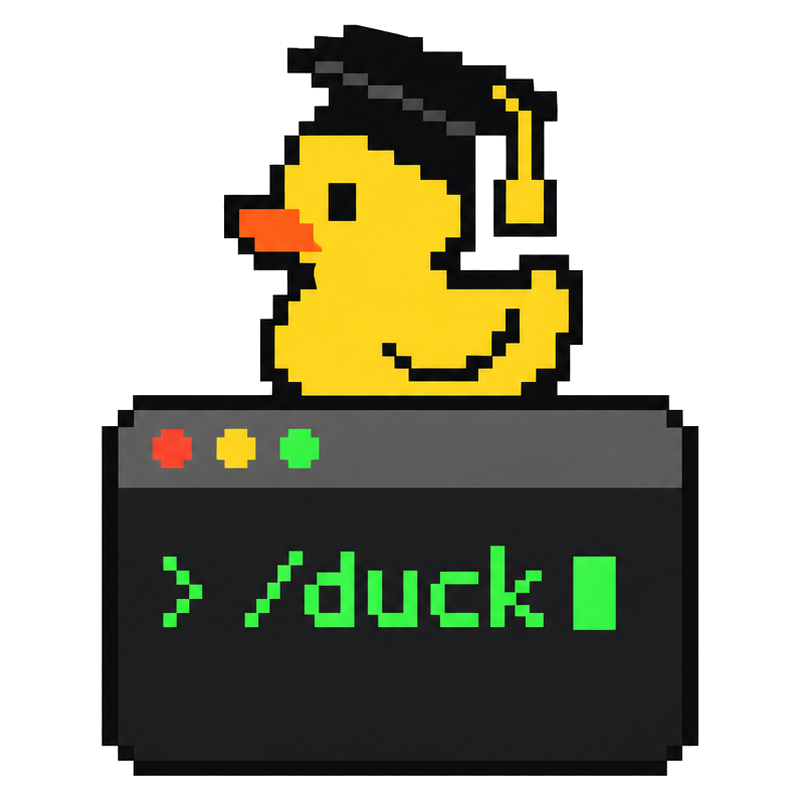
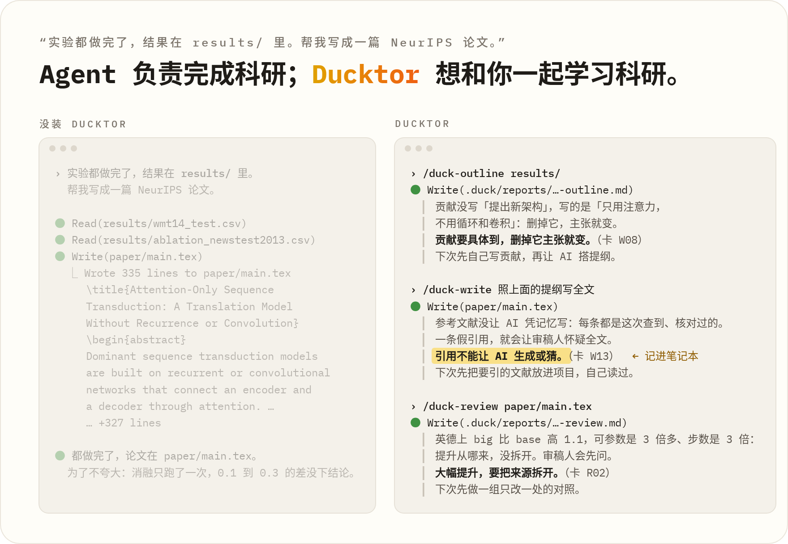

<p align="center">
  <picture>
    <source media="(prefers-color-scheme: dark)" srcset="assets/logo-dark.png">
    
  </picture>
</p>

<h1 align="center">Ducktor</h1>

<p align="center">
  <em>AI 做研究。Ducktor 讲为什么。道理你带走。</em>
</p>

<p align="center">
  <sub>Trust me, I'm a Ducktor.</sub>
</p>

<p align="center">
  
  
</p>

<p align="center">
  
</p>

<p align="center">
  <strong>贡献怎么定、话说多满、跟谁比，AI 替你定了。</strong><br>
  <strong>Ducktor 把这些判断拆开，一条一条讲给你。</strong><br>
  <strong>讲到的原则，记进你的笔记本。</strong><br>
  <sub>用在 Claude Code 和 Codex 里。道理标明出处，找不到出处，Ducktor 就直说是它自己的判断。</sub>
</p>

<p align="center">
  <sub>简体中文 &middot; <a href="i18n/README.en.md">English</a></sub>
</p>

---

你认识它：程序员桌上那只黄色的橡皮鸭。程序出了 bug，你把代码一行一行讲给它听，讲着讲着，自己就找到了 bug。

现在 AI 替你做研究，轮不到你讲了。Ducktor 反过来：它把 AI 做过的判断讲给你听。

## 之前 / 之后

<p align="center">
  
</p>

你把实验结果交给 AI，让它写成论文。没有 Ducktor，AI 一口气写完。贡献怎么定、话说多满、拿什么比，这些判断都是 AI 做的。它也许在最后提几句，但不拆成道理，不给出处，也不记下来。

用 Ducktor 的命令，同一件事分几步做。`/duck-outline` 理清逻辑，`/duck-write` 写正文，`/duck-review` 按审稿人的眼光审稿。每条命令做完，Ducktor 讲这一步的关键取舍，给一条带得走的原则，再说下次你自己可以先做什么。

## 问 Ducktor

AI 已经做完了，你也可以事后问。敲 `/duck`，后面直接接问题，比如 `/duck 可不可以告诉我这个内容里我要学什么？`。Ducktor 先说按哪条命令处理，再照那条命令讲。上面动图里，它挑的是复盘（`/duck-learn`）。

`/duck-why` 讲 AI 刚才那一步。它只挑一件最值得学的事：常见的做法是什么，有经验的研究者怎么想，哪位名家写过这个道理。提到数字或改动时，它说去哪个文件核对。讲完加粗一句原则，再一句「下次」，是你下次可以先做的事。你也可以指定一个文件、一次 git 提交或一个段落。

## 复盘

`/duck-learn` 在一段工作做完时复盘。它先问你：哪一步是你定的，哪一步最想重来。你可以不答。然后它读这一段的决策、报告和笔记。它讲本来想做什么、实际怎样、有经验的导师会盯哪里。它列出哪些判断交给了 AI，最后给下一步。你答了的话，下一步会用上你的回答。

## 笔记本和决策记录

Ducktor 记下的原则，每条一行，在 `.duck/notebook.md` 里。有取舍的决定，每条一行，记进 `.duck/decisions.md`，写明是你定的还是 AI 定的。下次敲命令做同类的事，Ducktor 先翻笔记本，用得上的旧条目会点出来。你说「这类我懂了」，这一类以后只记不讲。

什么时候记：在项目里打开 Ducktor 以后（`/duck on`，或者只记不讲的 `/duck quiet`），命令做完记一条；平时做完一步实质性的工作，能提炼出一条原则也记，意思重复的不记。没打开时，只有敲命令才记。`/duck off` 以后什么都不记，`/duck-why`、`/duck-learn` 只在对话里讲。

这些记录都是项目里的普通 markdown 文件，可以和论文一起提交进 git。组会上导师问「这个为什么这么定」，你翻得出来。

## 道理从哪来

Ducktor 讲道理时，名家和出处只从这几处取：

- [经验卡](cards/INDEX.md)，插件带 23 张。每张写一条道理、什么时候用、怎么用，以及出处。比如卡 W11：用词强度跟证据强度对齐。
- [名家文章索引](cards/MENTORS.md)。Hamming、Schulman、Karpathy 等研究者写过讲科研的文章。每篇用我们自己的话转述要点，附原文链接。
- [科研手册](handbook/)，来自 [Supervisor-Skills](https://github.com/HKUSTDial/Supervisor-Skills)。
- 你们组自己加的卡，用 `/duck-skill` 加。和插件的卡冲突时，以你们的为准。

找不到出处时，Ducktor 直说这是它自己的判断。

## 工作原理

Ducktor 不换掉你的 AI。它是一组规则和命令，你的 AI 照着它们当导师。

刚装好时，Ducktor 不出声，只在你敲 `/duck-*` 命令时干活。在一个项目里敲 `/duck on`，它就在这个项目里一直跟着：

- AI 做完一步实质性的工作，比如定了方法、改了实验、写完一段，Ducktor 在回复末尾讲一句为什么。
- 会改变做法的决定，AI 动手之前先问你，一次最多问三件。
- 有取舍时，Ducktor 记一行决策，写明是你定的还是 AI 定的。

`/duck quiet` 照样先问、照样记，只是不在对话里讲。

开着 Ducktor 时，你让 AI 把实验结果写进表或结论，它先查三件事。查到问题，它先停下来问你：

1. 只跑了一次吗？差距和种子之间的波动比过吗？
2. 提升很大时，来源拆清楚了吗？
3. 结论比证据说得更强吗？

敲 `/duck-*` 命令时，AI 照命令自己的步骤走，这三件不拦命令；命令做完，会用经验卡提醒。

这一条有对比：AI 碰到「把新结果加进表，摘要里补一句更好」时，开着 Ducktor 和没开时各怎么做。设置和对话原文见 [evals/before-after/](evals/before-after/)。

`/duck-survey`、`/duck-review` 这类命令里，AI 照 [Supervisor-Skills](https://github.com/HKUSTDial/Supervisor-Skills) 的科研技能干活。这套技能是 HKUSTDial 开源的，一共 10 个，从文献综述、评估 idea 到投稿前审稿。

Ducktor 不出题，也不给你这个人打分。

## 规则

开着 Ducktor 的项目，每个会话开头都加载常驻规则 [`rules/core.md`](rules/core.md)。给只读规则文件的 AI 工具用的版本是 [`AGENTS.md`](AGENTS.md)。14 条命令在 [`skills/`](skills/)，10 个科研技能原样放在 [`library/`](library/)。经验卡和名家文章索引在 [`cards/`](cards/)，科研手册在 [`handbook/`](handbook/)。其余的文件，有的把这些装进不同的 AI 工具，有的是测试和文档。

## 安装

需要 Node.js 18 或更高版本。仓库现在是私有的，你的 GitHub 账号要先拿到访问权限。

**Claude Code**，在终端里：

```bash
claude plugin marketplace add JoeyWu-tech/Ducktor
claude plugin install duck@ducktor
```

**Codex：**

```bash
codex plugin marketplace add JoeyWu-tech/Ducktor
codex plugin add duck@ducktor
```

然后在 Codex 里打开 `/hooks`，信任 Ducktor 的两条 hook，再开一个新会话。

**其他 AI 工具：**把仓库放到本机。把 [`AGENTS.md`](AGENTS.md) 复制到你的项目里。告诉 AI 仓库放在哪。这样有常驻规则，没有斜杠命令；要用某条命令，就说「照 Ducktor 的 /duck-review 做」。Cursor、Gemini CLI、Qwen Code 有适配文件，还没有实测：**[docs/agent-portability.md](docs/agent-portability.md)**。

就这些。在 Claude Code 里，到项目最外层的文件夹开一个新会话，敲 `/duck`；Codex 里敲 `$duck:duck`。Ducktor 先说一句最省事的用法，再列出菜单。

想让 Ducktor 平时也跟着，在项目里敲一次 `/duck on`。开关记在这个项目的 `.duck/config.md` 里，别的项目不受影响。在 `paper/` 这样的子文件夹里开会话，Ducktor 读不到开关。

完整流程只用本地副本测过；从 GitHub 安装，只测过能装上。更新、卸载和常见问题见 [INSTALL.md](INSTALL.md)。

## 命令

| 命令 | 作用 |
|------|------|
| `/duck [on \| quiet \| off]` | 不带参数时列出菜单。`on` 在这个项目里打开 Ducktor，`quiet` 只记不讲。`off` 关掉：命令照样能用，但不讲为什么，也不自动记录；`/duck-why`、`/duck-learn` 照常讲。后面接一句话时，比如 `/duck 帮我写引言`，它替你挑一条命令，先说挑了哪条，再做。 |
| `/duck-survey` | 找研究方向，做文献综述。 |
| `/duck-idea` | 评估一个 idea 值不值得做。 |
| `/duck-vibe` | 判断这块活让 AI 干到哪一步，哪些由你自己把关。 |
| `/duck-outline` | 理清论文的逻辑。技术论文和 benchmark 论文各有一个模板。 |
| `/duck-intro` | 写引言。 |
| `/duck-write` | 写正文。 |
| `/duck-figure` | 设计图，检查出图质量。 |
| `/duck-polish` | 润色。 |
| `/duck-review` | 投稿前，用审稿人的标准审你自己的稿子。 |
| `/duck-why` | 讲刚才那一步。也可以指定文件、git 提交或段落。 |
| `/duck-learn` | 一段工作做完时复盘。 |
| `/duck-notes` | 看、改笔记本。 |
| `/duck-skill` | 关掉或打开命令。改这个项目里的命令和规则，插件本身不变。加你们组自己的经验卡。 |

命令要装整个插件才能用，因为九条包装命令要读 `library/` 里的科研技能。在 Codex 里，`/duck-review` 写成 `$duck:duck-review`，其他命令照此类推。只读 `AGENTS.md` 的 AI 工具只加载常驻规则，敲不了这些命令。

## 常见问题

**要配置文件吗？**
不用。`/duck on` 会在项目里建 `.duck/config.md`。你可以用 `/duck-skill` 关掉命令或加卡。这些都可以不做。

**它会一直问我吗？**
不会。只有会改变做法的决定才问，一次最多三件。改错别字、只改一两句这类小事，它也不讲为什么。

**它会改我的论文吗？**
你让 AI 改，AI 才改。开着 Ducktor 时，结果要写进论文，它先查证据。证据不够，它先问你。

**我就想让它直接改呢？**
说一句「这次不用问我，你直接定。」AI 就不先问了。它照样记一行决策，写明是 AI 定的。

**Ducktor 讲的会错吗？**
会。讲这次过程的那几句，是 AI 根据代码和记录重建的，不是 AI 内部过程的回放。数字和改动，自己对一遍原文件；用 `/duck-why` 时，它会说去哪个文件核对。

**会把我的东西发出去吗？**
插件的开场脚本只读文件，不联网，也不写文件。AI 读到的内容照常发给模型。`/duck-survey`、`/duck-idea`、`/duck-review` 这类命令会让 AI 上网查文献。

**它给我打分吗？**
不给你打分。`/duck-idea` 给 idea 打分，`/duck-review` 给稿子打分，评的是东西，不是你。

**为什么叫 Ducktor？**
开头那只橡皮鸭，现在读完博士了。

## 来源和致谢

- 名字来自小黄鸭调试法（[Rubber duck debugging](https://en.wikipedia.org/wiki/Rubber_duck_debugging)），出自《程序员修炼之道》（The Pragmatic Programmer）。
- 方法论、手册和 10 个科研技能来自 [Supervisor-Skills](https://github.com/HKUSTDial/Supervisor-Skills)。Copyright (c) 2026 Yuyu Luo (methodology) and contributors。本仓库的提交历史从上游 c243997（2026-07-01）分出来。上游到那时为止的提交和作者都保留着。`library/` 和 `handbook/` 的内容取自上游 aff5de9（2026-07-16）。
- README 两张图里的论文数字，取自《Attention Is All You Need》（[arXiv 1706.03762](https://arxiv.org/abs/1706.03762)）的表 2 和表 3。
- README 的结构和写法参考了 [ponytail](https://github.com/DietrichGebert/ponytail)（MIT）。支持多种 AI 工具的做法参考了 ponytail 和 [superpowers](https://github.com/obra/superpowers)。

## 许可证

按目录分。我们写的文字（`skills/`、`rules/`、`cards/`）、`handbook/` 和 README 的图（`assets/`）用 CC BY-NC-SA 4.0，不可商用。代码（`bin/`、`hooks/`、`scripts/`、`tests/`）用 MIT。`library/` 里的科研技能保留各自原来的许可：6 个用 CC BY 4.0，4 个用 CC BY-NC-SA 4.0。详见 [LICENSE](LICENSE) 和 [LICENSES/README.md](LICENSES/README.md)。
