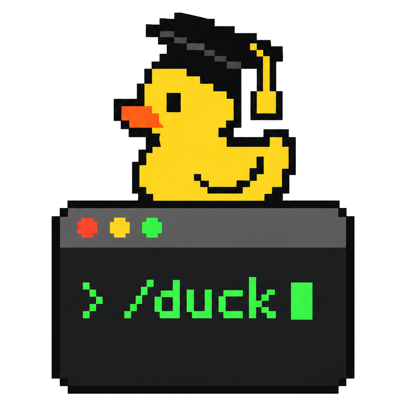

<p align="center">
  <picture>
    <source media="(prefers-color-scheme: dark)" srcset="../assets/logo-dark.png">
    
  </picture>
</p>

<h1 align="center">Ducktor</h1>

<p align="center">
  The next step of
  <a href="https://github.com/HKUSTDial/Supervisor-Skills"><b>Supervisor-Skills</b></a>
  <a href="https://github.com/HKUSTDial/Supervisor-Skills/stargazers"></a>
</p>

<p align="center">
  <b>A methodology and learning-loop plugin for research in the age of AI</b><br>
  When agents turn research into a black box of <code>Data In, Paper Out</code>, how does a researcher avoid becoming a passive spectator?<br>
  Ducktor works with the main agent harnesses. While your research moves forward, it adds the missing mentor guidance and the training loop of research.<br>
  <b>Trust me, I'm a Ducktor.</b>
</p>

<p align="center">
  <sub>Early Preview. Issues and PRs are welcome, and we iterate quickly.</sub>
</p>

<p align="center">
  
  <a href="#license"></a>
</p>

<p align="center">
  
</p>

<p align="center">
  <sub><a href="../README.md">简体中文</a> · English</sub><br>
  <sub>This file is a translation of the Chinese README. If the two files are different, the Chinese file is correct. The rules, the commands, and the experience cards are in Chinese, and we tested Ducktor mainly in Chinese.</sub>
</p>

---

## Why Ducktor

In the wave of **Vibe Research**, coding and research agents have greatly shortened the path from experiment to paper. After we open-sourced [Supervisor-Skills](https://github.com/HKUSTDial/Supervisor-Skills) () and it was widely recognized in academia and industry, one question worried us more and more: **when AI takes over the details of execution, can researchers (especially senior undergraduates and junior graduate students) still learn real academic judgment from the research process?**

From community feedback, we found that many researchers rely on `Supervisor-Skills` for structured research knowledge, but a static skill library still lacks **guidance that comes with you, in real time**. At the same time, most automated research tools today are open-loop systems: **Data In, Paper Out**. The agent makes all the hidden decisions for you (how to define the core contribution, how strong a conclusion to state, how to attribute an ablation), and the human is left out of the thinking loop.

**Ducktor sets out to break this pattern of "faster execution, hollow understanding" and to build a learning loop for the researcher:**

1. **Bring in top academic taste**: the input is no longer only experimental data. The methods of top scholars, review standards, and the experience of your own group are also part of the context.
2. **Break the process down and stay aligned in real time**: at the key points where the agent moves the research forward, Ducktor shows the academic trade-offs behind them and turns hidden judgments into explicit principles that you can learn.
3. **Grow both skill and output**: while you polish a high-quality paper, Ducktor produces a traceable decision log and personal research notes, so that the researcher's academic intuition grows together with the agent.

<details>
<summary><b>💡 Why the name Ducktor?</b></summary>
<br>
The idea comes from <a href="https://en.wikipedia.org/wiki/Rubber_duck_debugging">rubber duck debugging</a> in software engineering: an engineer explains the code, line by line, to a rubber duck on the desk, and finds the blind spots and clears up the thinking while explaining. <b>Ducktor (Duck + Doctor/Mentor)</b> is this "academic rubber duck" in a graduation cap in your terminal: with frequent, light interactions about method, it helps you take back control of the research process and the depth of your thinking.
</details>

> [!TIP]
> **Using DeepSeek Harness?** Use [DeepSeek-Ducktor](https://github.com/yinwu01/DeepSeek-Ducktor/blob/main/docs/README.en.md): the same commands and rules as Ducktor, adapted to the features of DeepSeek Harness.

---

## The core experience: before vs. after

<p align="center">
  
</p>

When you give your experimental results to a regular AI to write the paper, the AI produces a first draft in one pass. **How to state the core contribution, how strong the wording of a conclusion may be, whether the baselines are reasonable**: the model decides all of these by itself, inside a black box. You may get a fluent draft, but you miss the most important training in method, and you plant problems for the later review.

With Ducktor, the same task becomes a transparent loop of teaching and research:
- Use `/duck-outline` to set the main line of the argument, `/duck-write` to write the body, and `/duck-review` to check the draft strictly, as a reviewer would.
- After each key stage, Ducktor explains **the most important trade-off of this step (Why)**, picking what applies from the common alternative, why this choice, and when it does not hold (when the step was routine, one sentence says so). When there is **a research principle that carries over (Principle)** or **an action you can take earlier next time (Next Time)**, it says that too and saves it to the notebook.

---

## Core mechanisms and workflow

Ducktor does not replace your underlying model. It is a light layer of rules, hooks and skills that leads your AI to act as a careful academic mentor.

### 1. Two modes and the "evidence guardrail"

After you install it, Ducktor is in **on-demand mode** by default. It steps in only when you call a `/duck-*` command. Run `/duck on` in the root folder of a project to turn on **companion mode** for that project (or use `/duck quiet` for a quiet mode: it still asks first and still records, but does not explain in the conversation):

* **Short notes on method, right away**: when the AI completes a research action that matters (it chooses a technical approach, changes the experiment design, or finishes a core paragraph), Ducktor adds one to three lines at the end of the reply about the research reasoning behind it.
* **Ask before key decisions**: for a major trade-off that changes the direction of the research, the AI asks you before it acts (at most 3 core questions at a time, so that it does not interrupt too much). If you said you want to decide a kind of judgment yourself, it always asks about that kind.
* **The "evidence guardrail" before results go into the paper**: in companion mode, when you ask the AI to put experimental data into a table or to draw a conclusion, Ducktor first checks three reviewer-level red lines (if it finds a problem, it stops before writing and asks you; in Claude Code it still sometimes edits the table first and then warns you):
  1. **Statistical significance**: did the experiment run only once? Is the gap larger than the variation of the result itself (random seeds, sampling of the test set)? Outside computer science, the standard of your field takes its place (for example sample size and power, effect sizes and confidence intervals).
  2. **Separated attribution**: when there is a large gain, is its source (for example, more parameters or more training steps vs. the method itself) clearly separated?
  3. **Claims match evidence**: is the wording of the conclusion stronger than what the current experimental evidence supports?

> 📌 *Note: when you run a `/duck-*` command, the workflow follows the steps of that command; the "Card reminders" section of the command's report lists a few consensus cards related to this output, and the reasoning of the most important one may be worked into the explanation when the command ends. For real conversations before and after Ducktor is on, see the evaluation set [evals/before-after/](../evals/before-after/).*

### 2. Ask afterwards (`/duck-why`) and look back on a stage (`/duck-learn`)

* **Ask right away (`/duck` & `/duck-why`)**: even after the AI has finished, you can type `/duck <your question>` at any time (for example, `/duck What research norms should I pay attention to in this step?`), and Ducktor sends it to the command that fits best. When you call `/duck-why`, Ducktor looks at the last action (or a file, Git commit, or paragraph that you name) and explains **the one judgment most worth learning**: the common way and why experienced researchers choose this one, when that does not hold, and where to check the data. If you made this call and never said why, it first asks what you were thinking, then builds on your answer. Ideas from well-known researchers and from the cards are turned into experience in the explanation; the sources go into the report, and it gives author, title and link when you ask.
* **Look back on a stage (`/duck-learn`)**: call it when a research stage comes to an end. It first reads the decision log, reports, notes and Git commits of this stretch. Then it compares the "original goal" with the "actual result", points out the weak spots an experienced advisor would examine, lists the judgments left to the AI, and gives one or two next steps; when the records touch the next steps of the last look-back, it says whether they were done. At the end it asks you to look back on one concrete decision: what you were thinking then, and how you would decide now (you can skip it). If you say you want to decide a kind of judgment yourself next time, it shows you the line for `.duck/config.md` and adds it once you agree, so that you take back academic ownership step by step.

### 3. Personal knowledge and decision history (`.duck/`)

Ducktor stores what you learn as plain-text Markdown in the `.duck/` folder of the project:

* **Research principle notebook (`.duck/notebook.md`)**: the principles, one per line. With Ducktor on, before similar work and whenever you run a `/duck-*` command, Ducktor finds the related principles and follows them. If you say "I already know this kind of principle", it then only records and stops repeating the lesson.
* **Decision log (`.duck/decisions.md`)**: the key trade-offs of the research, one per line, each marked with who decided ("you decided" or "AI decided").
* **Look-back and explanation reports (`.duck/reports/`)**: the full result, the grounds of the explanation and the card reminders of every command, plus the full analyses of `/duck-learn` and `/duck-why`.

All records are standard Markdown files. You can commit them to Git together with your paper and code (when your advisor asks in a group meeting "why did you design the experiment this way", you can trace it back at any time). If you do not want them in the repository, add `.duck/` to `.git/info/exclude`.

### 4. A traceable mentor knowledge base (no lectures from thin air)

To avoid the empty "correct but useless" talk of large models, when Ducktor explains a method, it draws only on the four sources below. In the conversation it turns them into experience; the sources go into the report or into the notebook line, and it gives them when you ask. If nothing fits, it says the point is the AI's own judgment:

* **[Experience cards](../cards/INDEX.md)**: 23 built-in cards on frequent research situations, each with when it applies, what to do, and where it comes from in the literature (for example, `W11`: the strength of the wording must match the strength of the experimental evidence).
* **[Mentors index](../cards/MENTORS.md)**: structured key points from classic essays on research method by Richard Hamming, John Schulman, Andrej Karpathy, Jennifer Widom and others, with links to the originals.
* **[Research handbook](../handbook/)**: a systematic research guide from [Supervisor-Skills](https://github.com/HKUSTDial/Supervisor-Skills).
* **Your group's own experience cards**: with `/duck-skill`, you can add the review preferences and writing standards of your lab (when they conflict with the built-in ones, your group's rules come first).

---

## Repository layout

A project with Ducktor on loads the always-on rules [`rules/core.md`](../rules/core.md) when each session starts ([`AGENTS.md`](../AGENTS.md) is the version for tools that support only a rules file). The main parts are:

* [`skills/`](../skills/): the definitions and workflow of the 14 interactive commands.
* [`library/`](../library/): the 10 core research skills of [Supervisor-Skills](https://github.com/HKUSTDial/Supervisor-Skills), in full (literature review, idea evaluation, pre-submission review, and more).
* [`cards/`](../cards/) & [`handbook/`](../handbook/): the built-in experience cards, the index of essays, and the research handbook.
* `bin/`, `hooks/`, `scripts/`: adapter scripts for many platforms and lifecycle hooks.

---

## Install and quick start

Let your agent help. Send it this message:

```text
Install the Ducktor plugin for me: https://github.com/yinwu01/Ducktor
Follow the steps in i18n/INSTALL.en.md in that repository, then tell me how to start.
```

You can also install it yourself with the steps below.

**Requirement**: Node.js 18 or a later version.
*(Note: if you installed the old `Doctor Duck` before, first remove it with the steps in [INSTALL.en.md](INSTALL.en.md).)*

### Claude Code

In a terminal:

```bash
claude plugin marketplace add yinwu01/Ducktor
claude plugin install duck@ducktor
```

### Codex

In a terminal:

```bash
codex plugin marketplace add yinwu01/Ducktor
codex plugin add duck@ducktor
```
After the install, open `/hooks` in Codex, trust the two hooks that Ducktor registers, and then start a new session.

### Other AI coding tools (Cursor / Gemini CLI / Qwen Code and more)

Clone this repository to your computer, copy [`AGENTS.md`](../AGENTS.md) into the root folder of your project, and tell the AI the local path of this repository in the conversation. In this mode the always-on rules work. There are no native slash commands, so use natural language (for example, *"Review the current draft with the Ducktor `/duck-review` workflow"*). For details on each platform, see **[docs/agent-portability.md](../docs/agent-portability.md)** (in Chinese).

### Check that it works

1. Start a new terminal session in the **top-level root folder** of the project (a new empty folder is also fine).
2. In Claude Code, type `/duck` (in Codex, `$duck:duck`). Ducktor shows a short getting-started note and the command menu.
3. To get mentor guidance in everyday conversation, run `/duck on` once. The mode is saved in `.duck/config.md` of the current project, and other projects do not change (note: do not start the session in a subfolder such as `paper/`, or Ducktor cannot read the configuration in the root folder).

> For updates, removal and troubleshooting, see **[INSTALL.en.md](INSTALL.en.md)**.

---

## Commands

| Command | What it does and when to use it |
| :--- | :--- |
| `/duck [on \| quiet \| off]` | **Main control and routing**. With no argument, it shows the menu; `on` turns on companion mode for the project; `quiet` turns on quiet recording mode; `off` goes back to on-demand mode. Followed by natural language (for example, `/duck help me write the introduction`), it picks and runs the matching command. |
| `/duck-survey` | **Literature survey**: explore a research direction and produce a structured literature review. |
| `/duck-idea` | **Idea evaluation**: examine the novelty, feasibility and likely review risks of a research idea. |
| `/duck-vibe` | **Human-AI division of work**: decide which work in the current module can go to the AI and which core scientific judgments the researcher must make. |
| `/duck-outline` | **Logical structure**: lay out the argument of the whole paper (templates for technical papers and benchmark papers). |
| `/duck-intro` | **Introduction**: build an introduction where background → challenge → method mapping → contribution fit tightly together. |
| `/duck-write` | **Body text**: write the method and experiment sections from real experimental evidence, with strict control of citations. |
| `/duck-figure` | **Figure design**: plan the structure of research figures and check their information density and conventions. |
| `/duck-polish` | **Academic polishing**: make the academic writing more precise, more readable and better paced. |
| `/duck-review` | **Mock review**: a full check of the draft before submission, from the strict view of a top-conference reviewer. |
| `/duck-why` | **Tracing the method**: a close look at the academic trade-offs and the sources behind the last action (or a file, commit or paragraph that you name). |
| `/duck-learn` | **Stage look-back**: compare the goal with the result, find the weak spots, and list the hidden decisions that you left to the AI. |
| `/duck-notes` | **Notebook**: view, search or edit the research principles saved in `.duck/notebook.md`. |
| `/duck-skill` | **Customize and extend**: turn single commands on or off, adjust rules for the current project, or add your group's own experience cards. |

*Note: the 9 core research workflow commands use the skill library in `library/`, so they need the full plugin install. In Codex, use `$duck:duck-review` in place of `/duck-review` (the same for the other commands).*

---

## FAQ

<details>
<summary><b>1. Do I have to write a configuration file by hand?</b></summary>
<br>
No. <code>/duck on</code> creates <code>.duck/config.md</code> in the project. Later you can turn single commands on or off or add your own experience cards with <code>/duck-skill</code>, or just say in the conversation "make the replies shorter" or "no need to explain this kind of point again", and the preference goes into the configuration. When you say "I want to decide this kind of thing myself", it shows you the line first and adds it once you agree; when you say "just explain, don't ask me first" in <code>/duck-why</code> or <code>/duck-learn</code>, those two commands just explain from then on.
</details>

<details>
<summary><b>2. Does a project without <code>/duck on</code> use extra context?</b></summary>
<br>
Almost none. In a project without companion mode, the session hook adds only a very short note to the model context (where the plugin is, and that it is off in this project), and the AI works as it normally does. Only when you call a <code>/duck-*</code> command does it load the rules for that command. After <code>/duck on</code>, it adds the full always-on mentor rules.
</details>

<details>
<summary><b>3. Will it interrupt my work often, or change my paper on its own?</b></summary>
<br>
<b>It does not interrupt often</b>: the AI asks first only for a major trade-off that changes the direction of the research or breaks the evidence guardrail (and asks at most 3 questions at a time); routine work such as fixing spelling or polishing one sentence goes ahead directly.<br>
<b>It does not change your draft on its own</b>: the AI changes your paper and code only when you tell it to, but it sometimes also changes places you did not mention this turn (it usually says so in the reply), so look at the changes after each turn; with Ducktor on, it appends decisions, notes and reports to <code>.duck/</code> by itself. When you insist on your own wording and it disagrees, it tells you what that costs and offers one fix, and you choose; it does not rewrite your draft its own way. When you want to delete a sentence such as "results are from a single run", it says once what deleting it changes; if you insist, it deletes it and records the decision as "you decided". If you are in a hurry and want to skip the questions, just say <i>"No need to ask this time, you decide"</i>, and the AI goes ahead and records the decision as "AI decided" in the log; with Ducktor on, before it writes a result the evidence does not support into the paper, it still says once what is missing.
</details>

<details>
<summary><b>4. Can the methods Ducktor explains, or the data it quotes, be wrong (hallucinations)?</b></summary>
<br>
<b>Yes, they can. Always keep the final check as the researcher.</b> The model can still get the experimental numbers in your draft or the conclusions of other papers wrong when it restates them: for outside papers, always click the link and check the title and abstract; for numbers in your own text, check them against the source files (<code>/duck-why</code> gives the file paths and line numbers to check). Also, in a look-back, the analysis of "why the AI did it this way" is inferred afterwards from file changes and the conversation history, and does not show the real internal reasoning of the underlying model.
</details>

<details>
<summary><b>5. What are the permission limits of the plugin, and how is data privacy kept?</b></summary>
<br>
The local hook scripts of the plugin only read local files. <b>They never go online, and they do not change your code on their own.</b> In Claude Code, the hooks let only two kinds of safe actions through without a prompt: (1) reading files in the plugin's own folder; (2) after <code>.duck/</code> exists, appending entries to the notebook and the decision log and writing look-back reports. In the default permission mode, changing existing notes, changing the configuration (<code>config.md</code>), or changing skills and cards (<code>skills/</code>, <code>cards/</code>) still asks for permission in the terminal as usual. If the AI uses Write to overwrite the whole notebook or decision log without keeping the old entries, the hook refuses; if the AI writes these two files with a shell command that names the path under <code>.duck/</code>, the hook refuses too and tells it to add the line with the edit tool; a shell write after <code>cd .duck</code>, or one done with python, is not caught yet. Also, commands such as <code>/duck-survey</code>, <code>/duck-idea</code> and <code>/duck-review</code> let the AI use search tools to find public literature online when needed. What the AI reads in your project goes to your model provider as usual, the same as without the plugin.
</details>

<details>
<summary><b>6. Does Ducktor grade the researcher?</b></summary>
<br>
No. Ducktor gives no tests and does not grade the user. <code>/duck-idea</code> evaluates how mature the research plan is, and <code>/duck-review</code> examines the quality of the manuscript: <b>we evaluate the object of research, not the researcher.</b>
</details>

---

## Sources and thanks

* **The name**: from rubber duck debugging ([Rubber Duck Debugging](https://en.wikipedia.org/wiki/Rubber_duck_debugging)), from the book *The Pragmatic Programmer*.
* **Core method and skill library**: the research handbook (`handbook/`) and the 10 underlying research skills (`library/`) come from [Supervisor-Skills](https://github.com/HKUSTDial/Supervisor-Skills), open-sourced by the Data Intelligence and Analytics Lab of the Hong Kong University of Science and Technology (Guangzhou) (Copyright © 2026 Yuyu Luo and contributors). The commit history of this repository grows from upstream `c243997` (2026-07-01) and keeps all upstream commits and authors; the content of `library/` and `handbook/` is synced from upstream `aff5de9` (2026-07-16).
* **Example data**: the comparison numbers in the README images come from Table 2 and Table 3 of the classic paper *Attention Is All You Need* ([arXiv:1706.03762](https://arxiv.org/abs/1706.03762)).
* **Engineering thanks**: the story of this README is inspired by [ponytail](https://github.com/DietrichGebert/ponytail) (MIT); the support for many agent harnesses follows `ponytail` and [superpowers](https://github.com/obra/superpowers).
* **The Supervisor series**: we now officially make Supervisor a series of our lab. [Supervisor-Skills](https://github.com/HKUSTDial/Supervisor-Skills) is the first in the series, and Ducktor and [DeepSeek-Ducktor](https://github.com/yinwu01/DeepSeek-Ducktor) are the second and the third. We will keep open-sourcing more work and collaborate with the community.

---

## License

This project uses different licenses for different folders:
* **Method documents and visual assets**: the original rules and cards of this project (`skills/`, `rules/`, `cards/`), the research handbook (`handbook/`) and the images (`assets/`) use **CC BY-NC-SA 4.0** (non-commercial, share alike).
* **Engineering code**: the scaffolding, hooks and test scripts (`bin/`, `hooks/`, `scripts/`, `tests/`) use **MIT**.
* **Upstream skill library**: the research skills in `library/` keep their own upstream licenses (6 use **CC BY 4.0**, 4 use **CC BY-NC-SA 4.0**).

For the full terms, see [LICENSE](../LICENSE) and [LICENSES/README.md](../LICENSES/README.md).

---

## Join the discussion group

The group has exceeded 200 members and can no longer be joined via QR code. Please scan to add the admin on WeChat (`xyp619`) with the remark **"Ducktor + your name"** to be invited in. You can also follow the official WeChat account of the **Data Intelligence and Analytics Lab (DIAL)** and **Xie Bro Talks Research** for research news, paper-writing tips, AI frontier updates, and research tool sharing.

By joining, you get:
- 🔔 First-hand updates on the project
- 💬 Exchange paper writing and AI-assisted research tips with peers
- 🎙️ Join occasional online Q&A and experience-sharing sessions

<table align="center">
  <tr>
    <td align="center" width="360">
      <strong>Discussion Group</strong>
    </td>
    <td align="center" width="360">
      <strong>Official Account</strong>
    </td>
    <td align="center" width="360">
      <strong>Research Updates</strong>
    </td>
  </tr>
  <tr>
    <td align="center" valign="middle" height="360">
      
    </td>
    <td align="center" valign="middle" height="360">
      
    </td>
    <td align="center" valign="middle" height="360">
      
    </td>
  </tr>
  <tr>
    <td align="center">
      <sub>Add admin xyp619 to join the group</sub>
    </td>
    <td align="center">
      <sub>Data Intelligence and Analytics Lab (DIAL)</sub>
    </td>
    <td align="center">
      <sub>Xie Bro Talks Research: AI, papers, and research tools</sub>
    </td>
  </tr>
</table>
